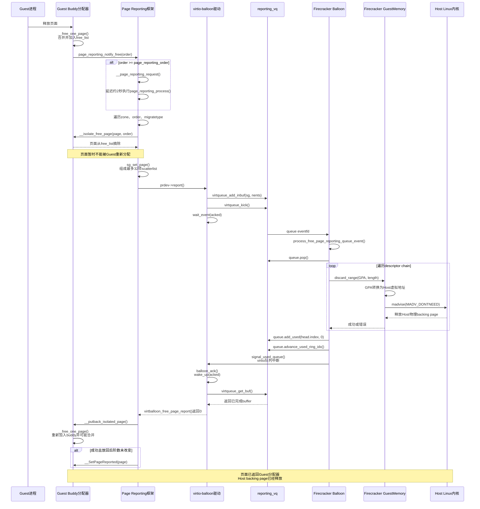

# Free Page Reporting

核心流程：

```text
__free_one_page -> page_reporting_notify_free->__page_reporting_notif->__page_reporting_request 这个函数里面会调用延迟队列 schedule_delayed_work(&prdev->work, PAGE_REPORTING_DELAY); 这个延迟队列实际执行的函数是 ，这里延迟两个节拍再调用 page_reporting_process ，然后 page_reporting_process_zone -> page_reporting_cycle->这里也是注册的回调函数virtballoon_free_page_report。之后kick函数就会等待 firecraker了就进入用户态，用户态完成后又会调 page_reporting_drain 函数
```

## 核心结构体

Free Page Reporting 涉及 Guest Linux 内核、virtio 传输层和 Firecracker VMM 三层。最核心的是 `struct page_reporting_dev_info`、`struct virtio_balloon`、`struct scatterlist`、`struct page`，以及 Firecracker 的 `Balloon` 和 Guest 内存映射结构。

### Guest 侧 Linux Page Reporting 框架

#### `struct page_reporting_dev_info`

```c
struct page_reporting_dev_info {
    int (*report)(
        struct page_reporting_dev_info *prdev,
        struct scatterlist *sg,
        unsigned int nents);

    struct delayed_work work;
    atomic_t state;
    unsigned int order;
};
```

这是 Page Reporting 框架与具体设备驱动之间的接口。

| 成员 | 作用 |
|---|---|
| `report` | 设备上报回调，virtio-balloon 设置为 `virtballoon_free_page_report()` |
| `work` | 延迟扫描 buddy 空闲页的工作项 |
| `state` | Reporting 状态机 |
| `order` | 驱动建议的最小上报阶数 |

状态值定义在 `mm/page_reporting.c`：

```c
enum {
    PAGE_REPORTING_IDLE = 0,
    PAGE_REPORTING_REQUESTED,
    PAGE_REPORTING_ACTIVE
};
```

含义如下：

* IDLE：没有Reporting任务
* REQUESTED：已收到请求，等待延迟工作执行
* ACTIVE：正在扫描和上报空闲页


该结构嵌入 `struct virtio_balloon` 中：

```c
struct virtio_balloon {
    ...
    struct page_reporting_dev_info pr_dev_info;
};
```

框架可以通过 container_of 找回对应的 balloon 设备。

在 Page Reporting 框架还维护一个全局 RCU 指针 pr_dev_info 指向 Balloon 驱动的 page_reporting_dev_info 结构。

```c
static struct page_reporting_dev_info __rcu *pr_dev_info __read_mostly;
```

这里使用 RCU 是因为页面释放是高频、敏感路径。这个路径不适合每次都获取全局 mutex。RCU 允许通知路径只进行轻量级读操作。

该结构体被嵌入到了 virtio_balloon 驱动当中

#### `struct virtio_balloon`

定义位置：[virtio_balloon.c](/Users/ylx/快手/kernel-6.6/drivers/virtio/virtio_balloon.c)

Reporting 使用其中三个核心成员：

```c
struct virtio_balloon {
    struct virtio_device *vdev;

    wait_queue_head_t acked;

    struct virtqueue *reporting_vq;
    struct page_reporting_dev_info pr_dev_info;

    ...
};
```

| 成员 | 作用 |
|---|---|
| `vdev` | virtio 设备对象，用于特性判断、队列操作和字节序处理 |
| `reporting_vq` | 向 Firecracker 提交空闲页块 |
| `pr_dev_info` | 向 Page Reporting 框架注册的接口对象 |
| `acked` | 等待 Firecracker 归还 used descriptor |

Reporting 初始化关系：

```c
vb->pr_dev_info.report =
    virtballoon_free_page_report;

page_reporting_register(&vb->pr_dev_info);
```

上报时：

```c
virtqueue_add_inbuf(vb->reporting_vq,sg,nents,vb,GFP_NOWAIT | __GFP_NOWARN);

virtqueue_kick(vb->reporting_vq);

wait_event(vb->acked,virtqueue_get_buf(vb->reporting_vq,&unused));
```

`struct virtio_balloon` 不保存 reporting 页面链表。页面只是临时存在于 Page Reporting 框架的 scatterlist 中。

#### `struct virtio_device`

`struct virtio_balloon` 通过下面的成员关联到 virtio 核心：

```c
struct virtio_device *vdev;
```

反向关系为：

```c
vdev->priv = vb;
```

它负责：

- 保存已协商的 virtio 特性；
- 提供配置空间访问方法；
- 创建、管理 virtqueue；
- 关联底层 virtio-mmio 或 virtio-pci 传输；
- 从 virtqueue 回调找回 balloon 设备。

判断 Reporting 是否启用通过：

```c
virtio_has_feature(
    vb->vdev,
    VIRTIO_BALLOON_F_REPORTING)
```

#### `struct virtqueue`

在 balloon 的结构体中包含了 reporting_vq 专用的 queue 通知的队列，用来将上报后的页面地址交给 Firecraker 进行处理。

```c
struct virtqueue *reporting_vq;
```

它代表 Guest 和 Firecracker 之间的 Reporting virtqueue。

这个队列会在 Balloon 驱动初始化的时候随着被一起初始化。

Reporting 一批 SG 条目被组织成一条 virtqueue descriptor chain。Firecracker 处理完成后把 chain head 放入 used ring。

```text
Descriptor 0
    addr = page A对应的Guest物理地址
    len  = 2 MiB
    next = Descriptor 1

Descriptor 1
    addr = page B对应的Guest物理地址
    len  = 2 MiB
    next = Descriptor 2

Descriptor 2
    addr = page C对应的Guest物理地址
    len  = 4 MiB
    next = 无
```


#### `struct scatterlist`

Page Reporting 使用 sgl 来记录

```c
struct scatterlist *sgl;
struct scatterlist {
    unsigned long page_link; // 页块头部的 struct page
    unsigned int offset;// 页内偏移，这里为0
    unsigned int length;// 整个连续页块的长度
    dma_addr_t dma_address;
};
```

分配32项数组：

```c
#define PAGE_REPORTING_CAPACITY 32
sgl = kmalloc_array( PAGE_REPORTING_CAPACITY,sizeof(*sgl), GFP_KERNEL);
```

加入一个页块时：

```c
sg_set_page(&sgl[offset],page,PAGE_SIZE << order,0);
```

它的作用是把不同阶数的空闲页块组织成一次批量 virtqueue 请求。

### Firecracker 侧结构体

#### Balloon

Firecracker 使用结构体：

```rust
pub struct Balloon {
    pub(crate) avail_features: u64,
    pub(crate) acked_features: u64,
    pub(crate) config_space: ConfigSpace,

    pub(crate) queues: Vec<Queue>,
    pub(crate) queue_evts: Vec<EventFd>,
    pub(crate) device_state: DeviceState,

    ...
}
```

Reporting 涉及：

| 成员 | 作用 |
|---|---|
| `avail_features` | 包含 Firecracker 提供的 reporting 特性 |
| `acked_features` | Guest 最终协商接受的特性 |
| `queues` | 包含 reporting virtqueue |
| `queue_evts` | Guest kick 队列时触发的 eventfd |
| `device_state` | 激活后保存 Guest memory 和中断控制对象 |

Firecracker 当前没有单独的 `reporting_queue` 字段，而是通过动态索引访问：

```rust
let idx = self.free_page_reporting_idx();
let queue = &mut self.queues[idx];
```

Reporting 处理入口：

```rust
process_free_page_reporting_queue_event()
    → process_free_page_reporting_queue()
```

#### BalloonConfig

```rust
pub struct BalloonConfig {
    pub amount_mib: u32,
    pub deflate_on_oom: bool,
    pub stats_polling_interval_s: u16,
    pub free_page_hinting: bool,
    pub free_page_reporting: bool,
}
```

其中：

```rust
free_page_reporting: true
```

使 Firecracker：

- 提供 `VIRTIO_BALLOON_F_FREE_PAGE_REPORTING`；
- 增加一条 virtqueue；
- 注册 reporting queue eventfd。

该配置只能在 microVM 启动前启用。

## 初始化过程

## 策略处理过程



这里 Free page reporting 可以大致分为这样几个阶段：

触发释放->空闲页面扫描->上报给 VMM->VMM 释放页面

## 3. Guest 释放页面并触发 Reporting

普通页面释放最终进入：

```text
free_pages()
  → __free_pages()
  → free_unref_page()
  → 页面从PCP排出时进入buddy
  → __free_one_page()
```

`__free_one_page()` 先尝试进行 buddy 合并，然后将最终形成的空闲块加入对应空闲链表：

```c
set_buddy_order(page, order);

add_to_free_list(page, zone, order, migratetype);

page_reporting_notify_free(order);
```

在 __free_one_page 函数的末尾会执行 page_reporting_notify_free 函数：

```text
page_reporting_notify_free()
  → __page_reporting_notify()
     → rcu_dereference(pr_dev_info)
     → __page_reporting_request(prdev)
```

状态机为：

```text
IDLE → REQUESTED → 延迟约2秒 → ACTIVE → 扫描期间出现新请求 → REQUESTED → 否则：IDLE
```

```c
static void
__page_reporting_request(struct page_reporting_dev_info *prdev)
{
	unsigned int state;
	state = atomic_read(&prdev->state);
	if (state == PAGE_REPORTING_REQUESTED)
		return;
	state = atomic_xchg(&prdev->state, PAGE_REPORTING_REQUESTED);
	if (state != PAGE_REPORTING_IDLE)
		return;
	schedule_delayed_work(&prdev->work, PAGE_REPORTING_DELAY);
}
```

其中：

```c
#define PAGE_REPORTING_DELAY (2 * HZ)
```

延迟两秒的目的是让更多高阶空闲块积累起来，减少频繁、小批量上报的开销。

Reporting 没有 Hinting 的 START、STOP、DONE 命令。它是 Guest 根据空闲页释放情况持续、事件驱动地运行。

---

## 5. Reporting 工作线程开始扫描

延迟任务执行：

```text
page_reporting_process()
  → atomic_set(state, PAGE_REPORTING_ACTIVE)
  → kmalloc_array(PAGE_REPORTING_CAPACITY,
                  sizeof(struct scatterlist))
  → sg_init_table()
  → for_each_zone(zone)
     → page_reporting_process_zone()
```

其中：

```c
#define PAGE_REPORTING_CAPACITY 32
```

表示一批最多有32个 SG 条目，不是32个基础页。每个条目可以代表一个高阶连续页块。

## 6. 检查 zone 是否有足够空闲内存

`page_reporting_process_zone()` 首先计算水位：

```c
watermark =
    low_wmark_pages(zone) +
    (PAGE_REPORTING_CAPACITY << page_reporting_order);
```

然后检查：

```c
if (!zone_watermark_ok(zone, 0, watermark,
                       0, ALLOC_CMA))
    return 0;
```

目的是确保隔离一批页面后，zone 仍然有足够空闲内存，不会因为 reporting 自己造成严重内存压力。

## 7. 遍历 buddy 空闲链表

框架按照：

```text
每个zone
  → 从page_reporting_order到MAX_ORDER
     → 每种migratetype
        → 对应free_list
```

具体结构为：

```c
for (order = page_reporting_order;
     order < NR_PAGE_ORDERS;
     order++) {
    for (mt = 0; mt < MIGRATE_TYPES; mt++) {
        if (is_migrate_isolate(mt))
            continue;

        page_reporting_cycle(prdev, zone,
                             order, mt,
                             sgl, &offset);
    }
}
```

真正扫描的链表是：

```c
struct free_area *area = &zone->free_area[order];

struct list_head *list =
    &area->free_list[mt];
```

已经带有 `PageReported` 标记的块会被跳过：

```c
if (PageReported(page))
    continue;
```

## 8. 从 buddy 隔离页面

找到未报告的空闲块后调用：

```c
__isolate_free_page(page, order);
```

内部完成：

```text
检查最低水位
  → 扣减zone空闲页统计
  → del_page_from_free_list()
     → 从free_list摘除
     → 清除PageBuddy
     → 清除可能存在的PageReported
  → 返回隔离的基础页数量
```

关键代码：

```c
watermark =
    zone->_watermark[WMARK_MIN] +
    (1UL << order);

if (!zone_watermark_ok(zone, 0, watermark,
                       0, ALLOC_CMA))
    return 0;

__mod_zone_freepage_state(zone,
                          -(1UL << order), mt);

del_page_from_free_list(page, zone, order);
```

隔离之后：

- 页面原本是 buddy 空闲页；
- 没有被 `alloc_pages()` 分配；
- 已从 buddy 链表摘除；
- buddy 空闲计数已经扣减；
- 普通 Guest 分配器无法取得；
- reporting 框架暂时拥有其生命周期。

这就是 Host 执行 `MADV_DONTNEED` 时不会和 Guest 重新分配发生竞态的关键。

## 9. 构造 scatterlist

隔离成功后：

```c
--(*offset);

sg_set_page(&sgl[*offset],
            page,
            PAGE_SIZE << order,
            0);
```

每个 SG 条目保存：

```text
sg_page(sg)  → 页块头页
sg->length   → PAGE_SIZE << order
sg->offset   → 0
```

同一批中可以包含不同 order 的页块。

当 SG 数组装满，框架释放 `zone->lock`，然后调用驱动：

```c
err = prdev->report(prdev,
                    sgl,
                    PAGE_REPORTING_CAPACITY);
```

必须先释放 `zone->lock`，因为 virtio-balloon 上报过程中需要睡眠等待 Firecracker ACK。

---

## 10. virtio-balloon 提交 Reporting 请求

驱动回调是：

```c
static int virtballoon_free_page_report(
    struct page_reporting_dev_info *pr_dev_info,
    struct scatterlist *sg,
    unsigned int nents)
```

首先通过内嵌结构找回设备：

```c
struct virtio_balloon *vb =
    container_of(pr_dev_info,
                 struct virtio_balloon,
                 pr_dev_info);
```

然后向 `reporting_vq` 提交：

```c
err = virtqueue_add_inbuf(
    vb->reporting_vq,
    sg,
    nents,
    vb,
    GFP_NOWAIT | __GFP_NOWARN);

if (WARN_ON_ONCE(err))
    return err;

virtqueue_kick(vb->reporting_vq);

wait_event(vb->acked,
           virtqueue_get_buf(
               vb->reporting_vq,
               &unused));

return 0;
```

这里使用 `virtqueue_add_inbuf()`，因此页面对应的 descriptor 对设备是 writable 的。Firecracker 实际不会通过 descriptor 写入数据，而是根据 descriptor 中的 GPA 和长度定位 backing memory。

Guest 在 `wait_event()` 中休眠期间，SG 中的页面仍处于隔离状态。

---

## 11. Firecracker 收到 reporting queue 事件

Guest 执行：

```c
virtqueue_kick(reporting_vq);
```

后触发 reporting queue 对应的 eventfd。

Firecracker 事件循环调用：

```text
MutEventSubscriber::process()
  → PROCESS_VIRTQ_FREE_PAGE_REPORTING
  → process_free_page_reporting_queue_event()
     → queue_evts[reporting_idx].read()
     → process_free_page_reporting_queue()
```

事件入口：

```rust
pub(crate) fn
process_free_page_reporting_queue_event(
    &mut self,
) -> Result<(), BalloonError> {
    self.queue_evts[
        self.free_page_reporting_idx()
    ].read()?;

    self.process_free_page_reporting_queue()
}
```

[Firecracker reporting 队列实现](https://github.com/firecracker-microvm/firecracker/blob/main/src/vmm/src/devices/virtio/balloon/device.rs)

## 12. Firecracker 遍历 descriptor chain

Firecracker 的核心处理函数为：

```rust
pub(crate) fn
process_free_page_reporting_queue(
    &mut self,
) -> Result<(), BalloonError> {
    let mem = &self
        .device_state
        .active_state()
        .ok_or(BalloonError::DeviceNotActive)?
        .mem;

    let idx = self.free_page_reporting_idx();
    let queue = &mut self.queues[idx];
    let mut needs_interrupt = false;

    while let Some(head) = queue.pop()? {
        let mut last_desc = Some(head);

        while let Some(desc) = last_desc {
            METRICS.free_page_report_count.inc();

            if let Err(err) =
                mem.discard_range(
                    desc.addr,
                    desc.len as usize)
            {
                METRICS.free_page_report_fails.inc();
                error!(
                    "balloon: failed to remove range: {err:?}"
                );
            } else {
                METRICS.free_page_report_freed
                    .add(desc.len as u64);
            }

            last_desc = desc.next_descriptor();
        }

        queue.add_used(head.index, 0)?;
        needs_interrupt = true;
    }

    queue.advance_used_ring_idx();

    if needs_interrupt {
        self.signal_used_queue(idx)?;
    }

    Ok(())
}
```

一个 Linux reporting 批次被提交为一个 descriptor chain：

```text
head descriptor
  → SG条目1：GPA + length
  → SG条目2：GPA + length
  → ...
  → SG条目N：GPA + length
```

Firecracker 对每个 descriptor 调用：

```rust
mem.discard_range(desc.addr, desc.len as usize)
```

`desc.addr` 是 Guest Physical Address，`desc.len` 是该连续页块的字节长度。

---

## 13. Firecracker 将 GPA 转为 Host 地址

`GuestMemoryMmap::discard_range()` 首先处理报告范围可能跨越多个 Guest 内存 region 的情况：

```rust
fn discard_range(
    &self,
    addr: GuestAddress,
    range_len: usize,
) -> Result<(), GuestMemoryError> {
    self.try_for_each_region_in_range(
        addr,
        range_len,
        |region, start, len| {
            region.discard_range(start, len)
        },
    )
}
```

对每个 Guest memory region：

```text
Guest GPA
  → 找到对应GuestRegionMmapExt
  → 计算region内部偏移
  → get_host_address()
  → 得到Firecracker进程中的Host虚拟地址
```

Firecracker 会检查地址和长度是否按 Host page size 对齐：

```rust
let page_size = host_page_size() as u64;

if !caddr.raw_value().is_multiple_of(page_size) ||
   !(len as u64).is_multiple_of(page_size) {
    return Err(...);
}
```

因此，Guest 的 `page_reporting_order` 最好让上报页块大小与 Host backing page 粒度相匹配。

---

## 14. Firecracker 对页面执行 `MADV_DONTNEED`

普通匿名 Guest 内存映射走：

```rust
let host_addr =
    self.get_host_address(caddr)?;

let ret = unsafe {
    libc::madvise(
        host_addr.cast(),
        len,
        libc::MADV_DONTNEED,
    )
};
```

完整关系为：

```text
Guest物理地址 GPA
  → Firecracker GuestMemoryMmap
  → Firecracker进程虚拟地址 HVA
  → madvise(HVA, length, MADV_DONTNEED)
  → Host Linux内核丢弃该范围的匿名物理页
```

`MADV_DONTNEED` 不会删除 Guest 的 GPA，也不会删除 KVM memory slot：

```text
Guest GPA布局：仍然存在
KVM memslot：仍然存在
Firecracker HVA范围：仍然存在
Host物理backing page：可以被释放
Firecracker RSS：通常下降
```

后续访问该 HVA 时，Host 内核会重新提供零页或零初始化的物理页。

Firecracker 官方文档明确说明 reporting 使用 `MADV_DONTNEED` 降低 Guest 对应的 Firecracker RSS。[Firecracker Balloon 文档](https://github.com/firecracker-microvm/firecracker/blob/main/docs/ballooning.md)

### Snapshot restore 的特殊处理

如果 Guest memory 来自 snapshot 文件，并通过 `MAP_PRIVATE` 映射，单纯执行 `MADV_DONTNEED` 会使后续访问重新读到 snapshot 文件中的旧内容。

因此 Firecracker 不直接 madvise，而是使用：

```rust
mmap(
    host_address,
    length,
    protection,
    MAP_FIXED |
    MAP_ANONYMOUS |
    MAP_PRIVATE |
    MAP_NORESERVE,
    -1,
    0,
);
```

在原地址上覆盖一段新的匿名零页映射。

这样后续 Guest 访问时看到的是零初始化页面，而不是 snapshot 文件中的历史内容。

[Firecracker `discard_range()` 实现](https://github.com/firecracker-microvm/firecracker/blob/main/src/vmm/src/vstate/memory.rs)

---

## 15. Firecracker 将 descriptor 放入 used ring

所有 descriptor 都处理完后：

```rust
queue.add_used(head.index, 0)?;
```

然后批量推进 used ring：

```rust
queue.advance_used_ring_idx();
```

最后产生 virtio 队列中断：

```rust
self.signal_used_queue(idx)?;
```

内部为：

```rust
interrupt_trigger.trigger(
    VirtioInterruptType::Queue(idx)
)
```

完整链为：

```text
discard_range完成
  → queue.add_used(head.index, 0)
  → queue.advance_used_ring_idx()
  → signal_used_queue(reporting_idx)
  → virtio MMIO/PCI队列中断
  → Guest virtio ring中断处理
  → reporting_vq callback
  → balloon_ack()
```

一个重要细节是：Firecracker 即使 `discard_range()` 失败，也会记录错误并继续执行 `queue.add_used()`：

```rust
if discard_range失败 {
    记录free_page_report_fails
    输出错误日志
}

queue.add_used(...)
```

used ring 表示“设备已经处理完 descriptor”，没有携带 `madvise()` 成功或失败状态。

所以 Host 回收失败只会损失一次内存回收机会，不会阻止 Guest 重新获得这些空闲页。

---

## 16. Guest 收到 Firecracker ACK

Firecracker 触发队列中断后，virtio 核心调用 reporting queue 回调：

```c
static void balloon_ack(struct virtqueue *vq)
{
    struct virtio_balloon *vb = vq->vdev->priv;

    wake_up(&vb->acked);
}
```

睡眠中的驱动重新检查：

```c
virtqueue_get_buf(reporting_vq, &unused)
```

取到刚才的 used descriptor 后：

```text
wait_event结束
  → virtballoon_free_page_report()返回0
  → page_reporting_cycle()重新获取zone->lock
  → page_reporting_drain()
```

注意，驱动返回的 `0` 只表示 virtqueue 请求正常完成。Firecracker 没有把 `MADV_DONTNEED` 的执行结果返回给 Guest。

---

## 17. Reporting 框架将页面放回 buddy

Guest 重新获得 `zone->lock` 后调用：

```c
page_reporting_drain(
    prdev,
    sgl,
    PAGE_REPORTING_CAPACITY,
    !err);
```

对每个 SG 条目执行：

```c
struct page *page = sg_page(sg);
int mt = get_pageblock_migratetype(page);
unsigned int order = get_order(sg->length);

__putback_isolated_page(page, order, mt);
```

底层为：

```c
__free_one_page(
    page,
    page_to_pfn(page),
    zone,
    order,
    mt,
    FPI_SKIP_REPORT_NOTIFY |
    FPI_TO_TAIL);
```

两个标志分别表示：

| 标志 | 作用 |
|---|---|
| `FPI_SKIP_REPORT_NOTIFY` | 本次放回不再次触发 reporting 通知 |
| `FPI_TO_TAIL` | 将页块倾向放到空闲链表尾部 |

`__free_one_page()` 会：

```text
恢复zone空闲页计数
  → 尝试与buddy合并
  → 设置PageBuddy和最终order
  → 放入free_area[order].free_list[mt]
```

此时页面重新可以被 Guest 普通分配器使用。

## 18. 设置 `PageReported`

如果 Firecracker ACK 正常，并且放回后页块没有和伙伴合并：

```c
if (PageBuddy(page) &&
    buddy_order(page) == order)
    __SetPageReported(page);
```

状态变成：

```text
Buddy空闲页
  + PageReported
  + 可以正常分配
  + 后续Reporting扫描会跳过
```

如果放回时发生合并：

```text
原order页块
  + 相邻buddy
  → 合并成更高order页块
```

原页块的阶数已经变化，因此不会设置 `PageReported`。后续扫描可以把新形成的高阶块重新报告给 Firecracker。

普通分配器以后取出该块时：

```c
static inline void
del_page_from_free_list(...)
{
    if (page_reported(page))
        __ClearPageReported(page);

    list_del(&page->buddy_list);
    __ClearPageBuddy(page);
    ...
}
```

所以 `PageReported` 只用于避免重复上报，不影响页面被正常分配。

---

## 19. 页面重新被 Guest 使用时发生什么

完成后的状态是：

```text
Guest侧：
    页面在buddy中，可以分配

Host侧：
    原来的物理backing page已被MADV_DONTNEED释放

地址映射：
    Guest GPA和Firecracker HVA仍然有效
```

当 Guest 再次分配并访问该页时：

```text
Guest分配页面
  → buddy摘除页面并清除PageReported
  → Guest CPU访问GPA
  → KVM访问Firecracker对应HVA
  → Host发现该HVA当前没有物理backing
  → Host产生缺页
  → 分配新的零初始化物理页
  → 建立映射
  → Guest继续执行
```

这个过程不再经过 virtio-balloon：

```text
不需要deflate请求
不需要通知Firecracker balloon设备
不需要从传统balloon链表取页
```

因为 Reporting 的协议语义就是：Firecracker ACK 后，Guest 可以直接复用页面。

---

## 20. 一次 Reporting 批次的状态变化

```text
① Buddy空闲页
   PageBuddy = 1
   Guest可分配
   Host backing存在

② __isolate_free_page()
   从buddy摘除
   Guest不可分配
   Host backing存在

③ virtqueue_add_inbuf() + kick
   Guest不可分配
   Firecracker正在处理

④ Firecracker discard_range()
   Guest不可分配
   Host backing被MADV_DONTNEED释放

⑤ Firecracker add_used() + 中断
   Guest不可分配
   Host处理完成

⑥ Guest virtqueue_get_buf()
   驱动确认ACK

⑦ __putback_isolated_page()
   页面回到buddy
   Guest可以重新分配
   Host backing尚不存在

⑧ Guest重新访问
   Host缺页并提供零初始化backing page
```

## 21. 整轮扫描如何结束

一个 zone 的所有链表处理完后，如果 SG 中还有不足32项的页面，框架会上报尾批：

```c
leftover = PAGE_REPORTING_CAPACITY - offset;

if (leftover) {
    err = prdev->report(prdev,
                        &sgl[offset],
                        leftover);

    spin_lock_irq(&zone->lock);
    page_reporting_drain(...);
    spin_unlock_irq(&zone->lock);
}
```

所有 zone 扫描完成后：

```c
kfree(sgl);

state = atomic_cmpxchg(
    &prdev->state,
    PAGE_REPORTING_ACTIVE,
    PAGE_REPORTING_IDLE);

if (state == PAGE_REPORTING_REQUESTED)
    schedule_delayed_work(
        &prdev->work,
        PAGE_REPORTING_DELAY);
```

因此：

```text
扫描期间没有新请求
  → ACTIVE → IDLE
  → 本轮结束

扫描期间又释放了符合条件的页
  → ACTIVE → REQUESTED
  → 约2秒后再运行一轮
```

Reporting 没有全局“结束命令”。每次扫描在处理完当前可报告页后结束，之后由新的 buddy 释放通知再次触发。