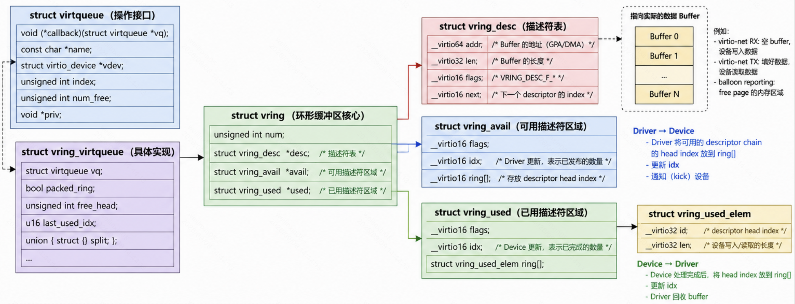
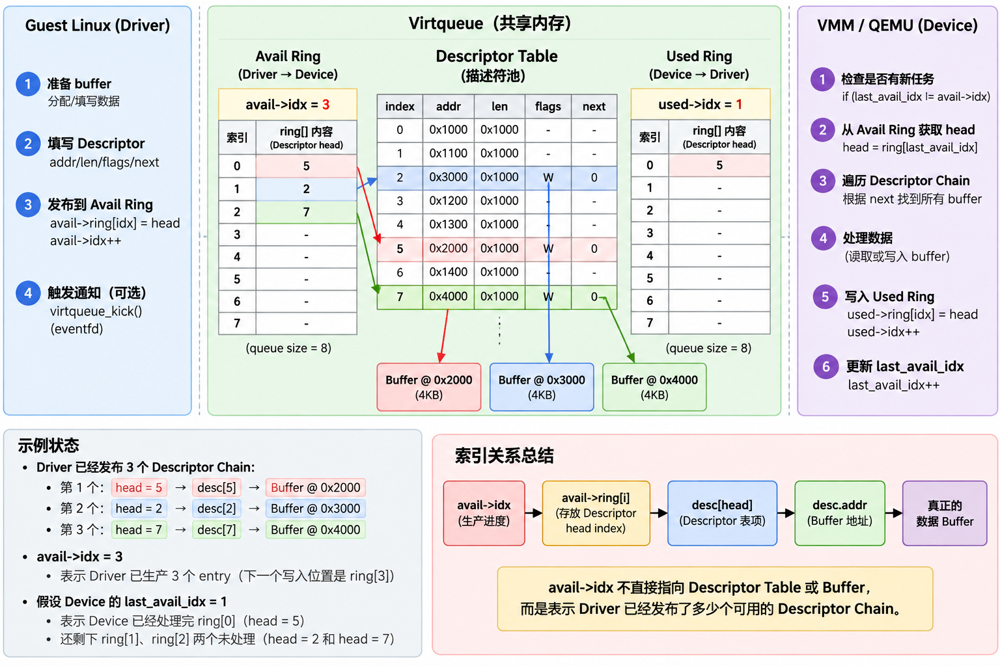
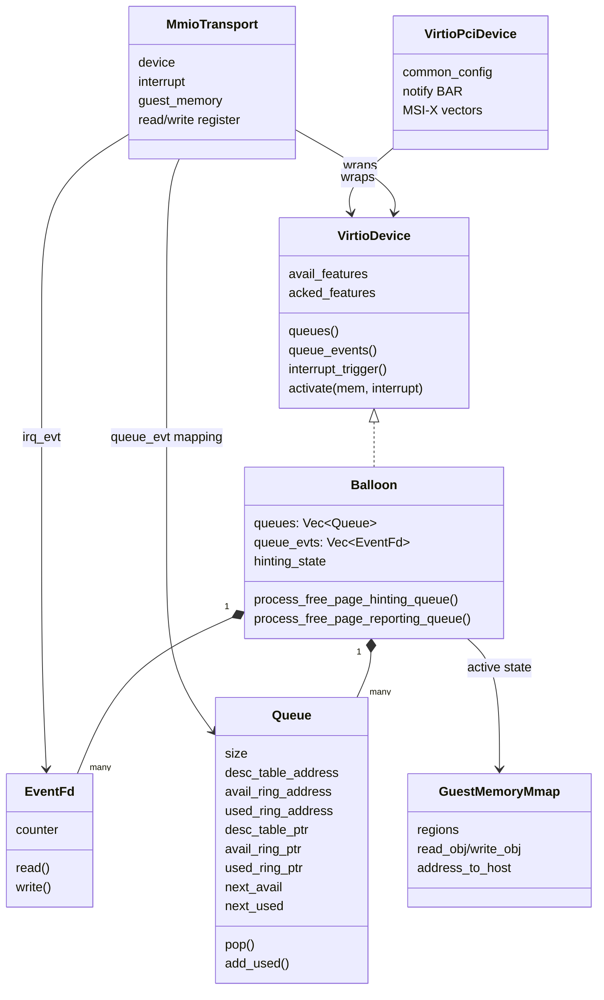
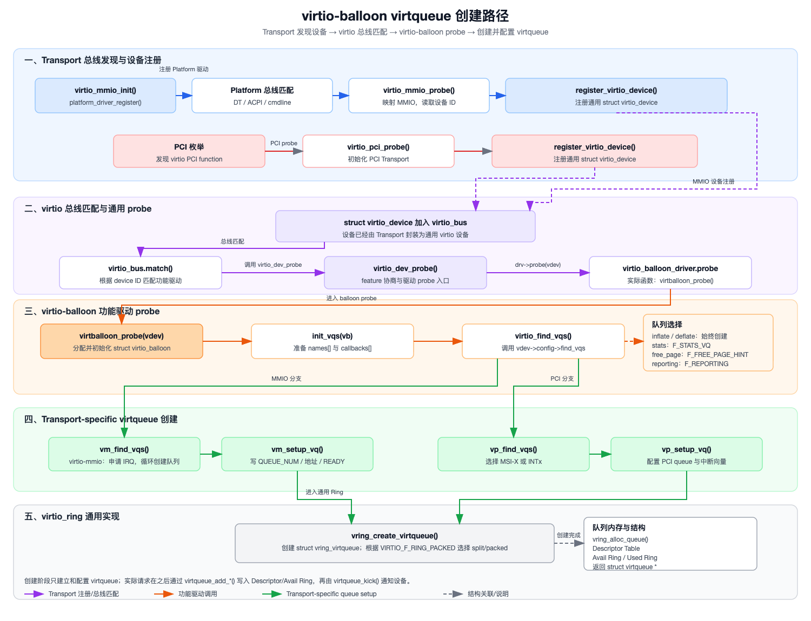
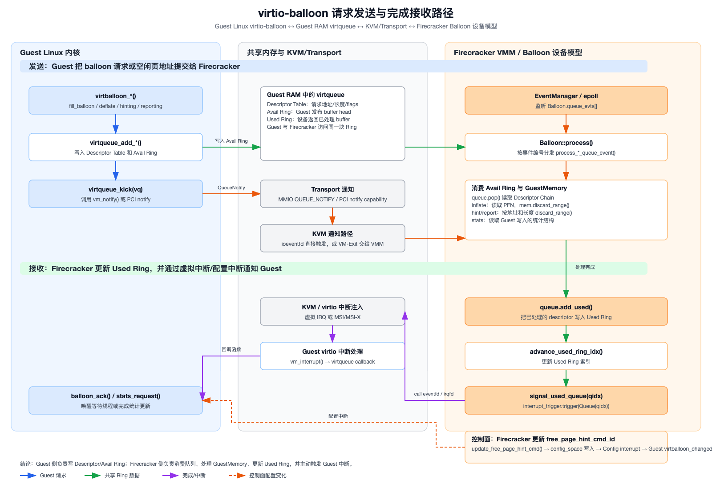
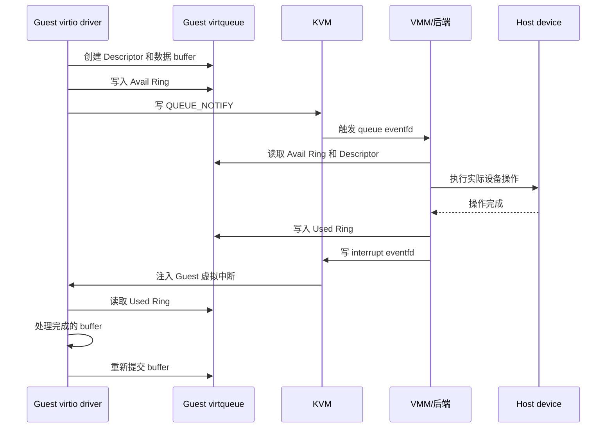

# virtio 事件通知机制

这里 vmm 为 firecarker，virtio 设备为 balloon。

## 核心结构体

### Guest 内核侧



#### 与 virtio_driver 的联系

```text
struct virtio_driver
    │
    │ 通过 .probe(struct virtio_device *vdev)
    ▼
struct virtio_device
    ├── dev.driver
    │     └── 指向当前绑定的 virtio_driver.driver
    ├── vqs
    │     └── 所有属于该设备的 virtqueue 链表
    └── priv
          └── 指向具体驱动的私有对象，例如 struct virtio_balloon
                    ├── inflate_vq
                    ├── deflate_vq
                    ├── stats_vq
                    ├── free_page_vq
                    └── reporting_vq
```

#### `struct virtqueue`

`struct virtqueue` 是 Linux 驱动看到的公共队列句柄：

```c
struct virtqueue {
    struct list_head list;
    void (*callback)(struct virtqueue *vq);
    const char *name;
    struct virtio_device *vdev;
    unsigned int index;
    unsigned int num_free;
    unsigned int num_max;
    void *priv;
};
```

它不直接展开 Split Ring 的所有字段。真正的实现对象是 `struct vring_virtqueue`，后者通过 `struct virtqueue vq` 嵌入公共句柄，并在 `vq->priv` 或 `container_of()` 关系中被具体实现使用。

#### `struct vring_virtqueue`

`struct vring_virtqueue` 是 Linux Guest 侧对一条 Virtqueue 的完整软件管理对象，定义在 [`virtio_ring.c:154`](</Users/ylx/快手/kernel-6.6/drivers/virtio/virtio_ring.c:154>)：

```c
struct vring_virtqueue {
    struct virtqueue vq;       /* 对外暴露的公共队列对象 */
    bool packed_ring;           /* 选择 Split 或 Packed Ring */
    bool broken;                /* 队列是否出错 */
    unsigned int free_head;     /* Guest 私有的空闲 Descriptor 链表 */
    unsigned int num_added;     /* 最近一次同步后新增的 buffer 数量 */
    u16 last_used_idx;          /* Guest 已消费的 Used Ring 位置 */
    union {
        struct vring_virtqueue_split split;
        struct vring_virtqueue_packed packed;
    };
    bool (*notify)(struct virtqueue *vq); /* transport 的 kick 回调 */
};
```

Split Ring 下，关键关系为：

```text
vq->split.vring.desc   → Descriptor Table
vq->split.vring.avail  → Avail Ring
vq->split.vring.used   → Used Ring
```

`desc_state`、`desc_extra` 是 Guest 内核自己的附加状态，例如原始 buffer 指针、DMA 地址和链表信息，不是 Virtio 协议中传给 Host 的业务数据。

#### vring

```c
struct vring {
	unsigned int num;

	vring_desc_t *desc;

	vring_avail_t *avail;

	vring_used_t *used;
};
```

Guest 内核与 VMM 之间通过共享内存中的一组 buffer 交换数据。vring_desc_t *desc 指向描述符表，其中的描述符记录 buffer 的地址、长度及读写方向等信息。

vring_avail_t *avail 指向可用环，记录 Guest 已提交、等待 Firecracker 处理的描述符链头编号，vring_used_t *used 指向已用环，记录 Firecracker 已处理完成的描述符链头编号及写入长度，供 Guest 回收或复用对应的 buffer。

也就是说，buffer 承载实际数据，描述符表描述 buffer，而 Avail Ring 和 Used Ring 分别传递待处理和已完成的请求。

这里buffer代表的语义到底是什么，由具体的 virtio 设备来决定。

```text
Descriptor Table[N]
├── addr：数据缓冲区 GPA
├── len：数据长度
├── flags：NEXT / WRITE / INDIRECT
└── next：下一个 Descriptor 的索引

Avail Ring
├── flags
├── idx：Guest 已发布的 Descriptor 数量
└── ring[]：Descriptor Chain 的 head 索引

Used Ring
├── flags
├── idx：Host 已完成的 Descriptor 数量
└── ring[]：UsedElement{id, len}
```

这里举个例子来说明这三者之间是如何联系的。

例如 queue size = 8，如果 avail->idx = 3 表示 Driver 已经发布了 3 个 Descriptor Chain。

假设 Avail Ring 内容：


```text
Avail Ring

       ring[0]  ring[1]  ring[2]
          5        2        7
          │        │        │
          ▼        ▼        ▼
       desc[5]   desc[2]   desc[7]
```

* avail->idx = 3：表示生产进度到了 3。
* avail->ring[2] = 7：表示第三次发布的 Descriptor Chain 的头是 desc[7]。
* desc[7].addr：才进一步指向真正的数据 Buffer。



### firecarker 侧



## 初始化

### firecarker 侧

这里以 firecarker 为例，这里不同的vmm初始化要做的事情是类似的，只是做事的方法不同。

firecarker 在这里的初始化大致分为这样几个阶段：

```text
1. Balloon::new()
   ├── 创建 Firecracker 的 Queue 对象
   └── 创建 queue_evt

2. register_mmio_virtio()
   ├── 分配 MMIO 地址
   ├── 创建 MmioTransport
   ├── 注册 Queue Notify → queue_evt
   ├── 注册 irq_evt → Guest 中断
   ├── 将 MmioTransport 插入 MMIO Bus
   └── 将 Balloon 加入 EventManager

3. 启动 vCPU
   └── KVM_RUN
       └── Guest Linux 开始执行

4. Guest virtio_mmio 驱动发现设备
   └── virtio_mmio_probe()
       └── virtio_balloon_probe()
           └── init_vqs()
               └── 分配 Guest 侧 vring

5. Guest 通过 MMIO 寄存器写入 Queue 配置
   ├── Descriptor Table GPA
   ├── Available Ring GPA
   ├── Used Ring GPA
   └── Queue Ready

6. Guest 写入 DRIVER_OK
   └── Balloon::activate()
       └── Queue::initialize()
           └── GPA → HVA
```

#### 解析配置文件初始化 Balloon 

在这一步会解析虚拟机启动时传入的配置文件，根据配置文件中的内容来选择初始化哪些设备。

```text
配置方式一：--config-file
        └── build_microvm_from_json()
            ├── VmResources::from_json()
               └── VmResources::set_balloon_device()
                   └── BalloonBuilder::set()
                       └── Balloon::new()
                           ├── Queue::new()
                           ├── EventFd::new()
                           |── 创建 queue_evt
                           └── 设置 feature bit 3/5

```

这里 Balloon设备有多种接入方式，这里默认是通过 MMIO 接入。

在 Balloon::new 当中，Firecracker 会按照配置文件中的配置 feature bit 3/5 向 Guest 说明要使用 free page hinting/reporting 的功能，并创建宿主机侧队列和 eventfd

```text
Balloon::new()
├── 创建 queues[i]
├── 创建 queue_evts[i]
├── 设置 avail_features
├── 初始化 config_space
└── 初始化 activate_evt
```

此时 Firecracker 中的 queues 会被创建出来，但是这些队列还都是空队列。
```text
Balloon
├── queues[0]       // inflate 队列的宿主侧 Queue
├── queues[1]       // deflate 队列的宿主侧 Queue
├── queues[2]       // stats 队列，可能存在
├── queues[...]     // hinting/reporting 队列，可能存在
│
├── queue_evts[0]   // 每个队列对应一个 eventfd
├── queue_evts[1]
└── queue_evts[...]
```

Queue 只是一个“空的宿主侧队列控制对象”，最初还不知道 Guest 的 Descriptor Table、Avail Ring 和 Used Ring 位于哪里。

queue_evt[i] 只是一个通知 fd，还不包含 virtio 请求数据。这里的内容还都是初始化的状态：

```text
Queue
├── size
├── ready = false
├── desc_table_address = 0
├── avail_ring_address = 0
├── used_ring_address = 0
├── desc_table_ptr = NULL
├── avail_ring_ptr = NULL
└── used_ring_ptr = NULL
```

#### 将 queue_evt 注册到 KVM 打通 MMIO 设备地址和通知通路

在虚拟机启动前执行完前面提到的 build_microvm_from_json 函数后，后面会进入到 build_and_boot_microvm 这个函数路径

```text
build_and_boot_microvm()
                ├── build_microvm_for_boot()
                    ├── allocate_guest_memory()
                    ├── KvmVm::new()
                    ├── create_vcpus()
                    ├── register_dram_memory_regions()
                    ├── load_kernel()
                    └── attach_balloon_device()
                       └── attach_boot_virtio_device()
                           └── attach_mmio_virtio_device()
                               ├── IrqTrigger::new()
                               ├── MmioTransport::new()
                               └── register_mmio_virtio_for_boot()
                                   ├── allocate_mmio_resources()
                                   ├── add_virtio_device_to_cmdline()
                                   └── register_mmio_virtio()
                                       ├── register_ioevent()
                                       ├── register_irq()
                                       ├── mmio_bus.insert()
                                       └── add_subscriber(balloon)
                    
```

在 register_mmio_virtio() 函数中会做以下几件事
* 分配 MMIO 地址
* 创建 MmioTransport
* 注册 Queue Notify → queue_evt
* 注册 irq_evt → Guest 中断
* 将 MmioTransport 插入 MMIO Bus
* 将 Balloon 加入 EventManager

这一步当中 register_ioevent() 建立的是 KVM 路由表：

```text
同一个 MMIO Notify 地址
    + 不同的 datamatch(queue_index)
        → 不同的 queue_evt
例如：

MMIO 地址       写入值       queue_evt
0xc0001050      0            queue_evt[0]
0xc0001050      1            queue_evt[1]
0xc0001050      2            queue_evt[2]
0xc0001050      3            queue_evt[3]
0xc0001050      4            queue_evt[4]
```

在后续使用中，Guest 侧通过kick会向 MMIO 的 notify 寄存器当中填入一个数字，这个数字的值会对应一个 queue_evt 的 fd。这里的这个路由表就是将 Guest 侧的写入值和要触发哪个 fd 联系到一起。

那Guest是怎么知道哪个号对应的是哪个queue队列呢？这里是由各个virtio设备自己达成了一套协议约定，固定的某一个号对应了一个 Guset 侧的队列。

这里在调用 register_ioevent() 后，底层会向 KVM VM fd 发起请求在 KVM cezhe：

```c
ioctl(vm_fd, KVM_IOEVENTFD, &kvm_ioeventfd)
```

这里的匹配关系会被注册到 KVM 当中。

这里同时调用 IrqTrigger 和 register_irq 创建了并关联了中断 eventfd。

```rust
IrqTrigger {
    irq_status,
    irq_evt: EventFd::new(...),
}
```

这个 irq_evt 用于两类 virtio 中断：

* Config 中断：配置发生变化
* Vring 中断：Used Ring 中有完成请求

```text
register_mmio_virtio()
└── vm.register_irq(irq_evt, gsi)
    ├── vmfd.register_irqfd(irq_evt, gsi)
    │   └── ioctl(KVM_IRQFD)
    └── 构造 GSI 路由项
        ├── gsi = gsi
        ├── type = KVM_IRQ_ROUTING_IRQCHIP
        ├── irqchip = KVM_IRQCHIP_IOAPIC
        └── pin = gsi
```

此时 Firecracker 建立的是：irq_evt → GSI。但是 GSI 到虚拟 IOAPIC 的路由项此时只是先保存到 Firecracker 的 interrupts 集合中。

这里 irq_evt eventfd 的等待队列负责在 irq_evt 被写入时唤醒 KVM 的 irqfd_wakeup() 回调；回调再使用已保存的 GSI 触发虚拟中断。

Firecracker 后续调用：

```text
vm.set_gsi_routes()
└── KVM_SET_GSI_ROUTING
    └── GSI → 虚拟 IOAPIC pin
```

完成 GSI → 虚拟 IOAPIC pin 的注册。

#### 创建 fc_vcpu 线程启动 Guset 内核

在 build_and_boot_microvm 当中还会创建 fc_vcpu 线程，在创建好之后就会启动 Guest 内核。

```text
configure_system_for_boot()
│   └── 设置 Guest 内核入口 RIP
│   ├── start_vcpus()
│   │   └── 创建 fc_vcpu 线程
│   └── EventManager::add_subscriber(vmm)
│
└── Vmm::resume_vm()
    └── KvmVm::resume_vcpus()
         └── Vcpu::run()
                └── Vcpu::run_emulation()
                    └── KVM_RUN
                            └── Guest Linux 启动
                                └── virtio_mmio 驱动
                                    └── virtio_balloon 驱动
                                        ├── 配置 Queue
                                        │   └── MmioTransport::write()
                                        ├── 写 DRIVER_OK
                                        │   └── Balloon::activate()
                                        │       ├── Queue::initialize()
                                        │       └── activate_evt.write()
                                        │           └── 注册运行期 queue_evt
```

#### Guest virtio_mmio 驱动发现设备并通过寄存器写入 Queue 配置

虚拟机启动后，Guest Linux 会发现 virtio-MMIO 设备：

``text
virtio_mmio_probe()
└── register_virtio_device()
    └── virtio_dev_probe()
        └── virtio_balloon_probe()
            └── init_vqs()
                └── 为每个队列分配 Guest 侧 vring
```

Guest 驱动会在 Guest 内存中分配：

```text
Guest 内存
├── Descriptor Table
├── Avail Ring
├── Used Ring
└── 数据缓冲区
```

然后 Guest 驱动通过 virtio-MMIO 寄存器把这些地址写给 Firecracker：

```text
Guest 写 QUEUE_SEL
    └── 选择队列编号 i

Guest 写 QUEUE_NUM
    └── 设置队列大小

Guest 写 QUEUE_DESC_LOW/HIGH
    └── 写入 Descriptor Table 的 GPA

Guest 写 QUEUE_DRIVER_LOW/HIGH
    └── 写入 Avail Ring 的 GPA

Guest 写 QUEUE_DEVICE_LOW/HIGH
    └── 写入 Used Ring 的 GPA

Guest 写 QUEUE_READY = 1
    └── 标记队列配置完成
```

以 MMIO 为例，Firecracker 的处理路径是：

```text
Guest MMIO 写
└── KVM_EXIT_MMIO
    └── Firecracker vCPU 退出处理
        └── mmio_bus.write()
            └── 找到 MmioTransport
                └── MmioTransport::write()
                    ├── 更新 queue_select
                    ├── 更新 queues[i].size
                    ├── 更新 queues[i].desc_table_address
                    ├── 更新 queues[i].avail_ring_address
                    ├── 更新 queues[i].used_ring_address
                    └── 更新 queues[i].ready
```

当 Guest 最后写入 DRIVER_OK 时，Firecracker 激活设备：

```text
MmioTransport::set_device_status(DRIVER_OK)
└── Balloon::activate()
    └── Queue::initialize(&guest_memory)
        ├── 根据 desc_table_address 获取 Descriptor Table 的宿主地址
        ├── 根据 avail_ring_address 获取 Avail Ring 的宿主地址
        └── 根据 used_ring_address 获取 Used Ring 的宿主地址
```

Queue::initialize() 内部会把 Guest GPA 转换成 Firecracker 可以访问的宿主虚拟地址：

```text
Guest GPA
    ↓
GuestMemoryMmap::get_slice()
    ↓
宿主 HVA 指针
    ↓
Queue.desc_table_ptr
Queue.avail_ring_ptr
Queue.used_ring_ptr
```

因此，Guest 队列和 Firecracker 队列的联系是：

```text
Guest 的 vring 位于 Guest RAM
        ↑
        │ 通过 GPA 配置
        │
Firecracker::Queue 保存这些 GPA
        ↓
Firecracker 将 GPA 转成 HVA 指针
        ↓
Firecracker 直接读写 Guest 的 Descriptor/Ring
```

两边并不是共享同一个 struct virtqueue，而是共享同一片 Guest 内存中的 virtqueue 数据结构。

最后完成后向 firecerker 返回 OK.

### Guest 内核侧



#### Transport 层的通用初始化


第一阶段是总线和 Transport 层的通用初始化。系统启动或模块加载时，先注册 virtio-mmio、virtio-pci 等 Transport 驱动。之后，Platform 总线或 PCI 总线发现对应的 virtio 设备，并调用相应的 Transport probe() 函数。

以 virtio-mmio 为例，virtio_mmio_probe() 会映射 MMIO 寄存器、读取设备版本和 Device ID、设置配置操作函数，然后通过 register_virtio_device() 创建并注册一个通用的 struct virtio_device。virtio-pci 也会执行类似流程，只是设备发现和寄存器访问方式不同。

#### Linux virtio 总线和驱动匹配

```text
virtio_init()
└── bus_register(&virtio_bus)

transport 探测到设备
└── register_virtio_device(vdev)
    └── device_register(&vdev->dev)
        └── virtio_bus.match()
            └── virtio_id_match()
                └── virtio_dev_probe()
                    ├── 驱动 validate()
                    ├── 读取设备 Feature
                    ├── 驱动 probe()
                    └── 驱动完成 virtio_device_ready()
```

通用 virtio_device 注册到 virtio 总线后，virtio 总线根据设备 ID 查找匹配的功能驱动，例如 virtio_balloon_driver。匹配成功后进入通用的 virtio_dev_probe()。这个函数负责获取设备和驱动支持的 feature，完成 feature 协商、配置提交和基本校验，之后才调用具体功能驱动的 probe() 函数。到这里为止，完成的是“设备被总线发现、注册、匹配和协商”的通用过程，Transport 层还没有创建 balloon 专用队列。

在 virtio_dev_probe 中会协商的 virtio 设备和驱动共同支持的功能特性位。

`virtio_dev_probe()` 会分别获得两组 feature：

```text
设备支持的 feature
└── dev->config->get_features(dev)

virtio-balloon 驱动支持的 feature
└── virtio_balloon_driver.feature_table
```

然后取交集：

```text
dev->features = device_features & driver_features;
```

在 virtio-balloon 中，驱动声明支持的主要功能包括：

```text
VIRTIO_BALLOON_F_MUST_TELL_HOST
    Guest 需要向 Host 告知气球页面变化

VIRTIO_BALLOON_F_STATS_VQ
    支持内存统计 virtqueue

VIRTIO_BALLOON_F_DEFLATE_ON_OOM
    Guest 内存不足时允许自动释放气球页面

VIRTIO_BALLOON_F_FREE_PAGE_HINT
    支持 Free Page Hinting

VIRTIO_BALLOON_F_PAGE_POISON
    对气球页面进行 poison 检查

VIRTIO_BALLOON_F_REPORTING
    支持 Free Page Reporting
```

除了 balloon 自身的功能，还会协商 virtio 通用和 Transport 相关的 feature，例如：

```text
VIRTIO_F_VERSION_1
    使用现代 virtio 1.x 协议

VIRTIO_F_RING_PACKED
    使用 packed ring，而不是 split ring

VIRTIO_F_EVENT_IDX
    支持基于事件索引的通知抑制

VIRTIO_F_INDIRECT_DESC
    支持间接 Descriptor

VIRTIO_F_NOTIFICATION_DATA
    QueueNotify 中携带额外通知数据

VIRTIO_F_ACCESS_PLATFORM
    是否需要平台 IOMMU/DMA 地址转换
```

协商完成后，驱动才能根据结果决定后续行为：

```text
协商成功 VIRTIO_BALLOON_F_STATS_VQ
    └── 创建 stats_vq

协商成功 VIRTIO_BALLOON_F_FREE_PAGE_HINT
    └── 创建 free_page_vq

协商成功 VIRTIO_BALLOON_F_REPORTING
    └── 创建 reporting_vq

协商成功 VIRTIO_F_RING_PACKED
    └── vring_create_virtqueue() 创建 packed ring
```

协商结果最终通过 Transport 的：

```c
dev->config->finalize_features(dev);
```

写回设备。之后 `virtballoon_probe()` 和 `init_vqs()` 使用 `dev->features` 判断可以启用哪些功能。

#### balloon 驱动初始化 

```text
virtio_dev_probe()
└── virtio_balloon_probe()
    ├── kzalloc(struct virtio_balloon)
    ├── 初始化 workqueue、锁、waitqueue 和统计字段
    ├── init_vqs()
    │   └── virtio_find_vqs()
    │       ├── inflate_vq
    │       ├── deflate_vq
    │       ├── stats_vq（可选）
    │       ├── free_page_vq（可选）
    │       └── reporting_vq（可选）
    ├── 注册 shrinker / OOM notifier（按 Feature）
    ├── page_reporting_register(&vb->pr_dev_info)
    └── virtio_device_ready(vdev)
```

第二阶段是 virtio-balloon 功能驱动自己的初始化过程。virtio_dev_probe() 调用 virtballoon_probe() 后，balloon 驱动会分配并初始化 struct virtio_balloon，设置锁、等待队列和工作项，然后进入 init_vqs()。init_vqs() 根据已经协商成功的 feature 准备各个队列的名称和回调函数。例如 inflate 和 deflate 队列通常始终需要，stats、free-page hinting 和 free-page reporting 队列则只有在对应 feature 启用时才创建。

#### 创建 virtioqueue

init_vqs() 调用通用接口 virtio_find_vqs()。这个接口会根据当前设备使用的 Transport，转调对应的 find_vqs()：virtio-mmio 进入 vm_find_vqs()，virtio-pci 进入 vp_find_vqs()。这些 Transport-specific 函数遍历需要创建的队列，并调用 vm_setup_vq() 或 vp_setup_vq()。

```c
//注册操作函数
static const struct virtio_config_ops virtio_mmio_config_ops = {
	.get		= vm_get,
	.set		= vm_set,
	.generation	= vm_generation,
	.get_status	= vm_get_status,
	.set_status	= vm_set_status,
	.reset		= vm_reset,
	.find_vqs	= vm_find_vqs,
	.del_vqs	= vm_del_vqs,
	.get_features	= vm_get_features,
	.finalize_features = vm_finalize_features,
	.bus_name	= vm_bus_name,
	.get_shm_region = vm_get_shm_region,
	.synchronize_cbs = vm_synchronize_cbs,
};
```

在 setup_vq() 中，内核调用通用的 vring_create_virtqueue() 创建实际的 Guest 侧 virtqueue，包括 Descriptor Table、Avail Ring 和 Used Ring，并根据协商结果选择 split ring 或 packed ring。

随后，Transport 将队列大小、Ring 的 Guest 物理地址以及队列状态写入 MMIO 或 PCI 配置空间，同时配置中断和通知信息。创建完成的队列指针最终保存到 virtio_balloon 对象中，供后续充气、放气、统计、Hinting 和 Reporting 操作使用。

这里在 virtio_balloon.c 先定义了 balloon 队列的逻辑索引

```text
enum virtio_balloon_vq {
	VIRTIO_BALLOON_VQ_INFLATE,   // 0
	VIRTIO_BALLOON_VQ_DEFLATE,   // 1
	VIRTIO_BALLOON_VQ_STATS,     // 2
	VIRTIO_BALLOON_VQ_FREE_PAGE, // 3
	VIRTIO_BALLOON_VQ_REPORTING, // 4
	VIRTIO_BALLOON_VQ_MAX
};
```

在 init_vqs() 中，内核创建一个临时的指针数组，'struct virtqueue *vqs[VIRTIO_BALLOON_VQ_MAX];' 这里在函数 vm_find_vqs 中会按照 enum 里面顺序依次创建virtioqueue 并将创建出的队列的地址存入数组之中返回给 init_vqs。在 init_vqs 函数中会按照 enum 协议中的内容将 virtqueue 与 virtio_balloon 中 'inflate_vq' 'deflate_vq' 的等等内容进行关联。

具体创建virtio的流程：

vm_find_vqs -> vm_setup_vq -> vring_create_virtqueue 

在前文中提到的通过 MMIO 的寄存器向firecarker 侧说明 Guest 侧的 queue 的位置、大小等各种情况就在该函数当中完成。

### Host kvm 侧

以 Firecracker 的 virtio-mmio 为例，KVM 侧主要需要初始化以下几部分。

#### 创建 VM 时初始化 eventfd 管理结构

VMM 执行：

```text
KVM_CREATE_VM
└── kvm_create_vm()
    └── kvm_eventfd_init(kvm)
        ├── 初始化 kvm->irqfds.items
        ├── 初始化 kvm->irqfds.resampler_list
        ├── 初始化 irqfd 相关锁
        └── 初始化 kvm->ioeventfds
```

代码见 [`kvm_main.c`](</Users/ylx/快手/kernel-6.6/virt/kvm/kvm_main.c:1166>) 和 [`eventfd.c`](</Users/ylx/快手/kernel-6.6/virt/kvm/eventfd.c:532)。

这一步只是初始化 KVM 内部保存 `ioeventfd` 和 `irqfd` 的链表、锁等，还没有注册具体 virtio 队列。

#### 注册 Guest 内存

VMM 还需要通过：

```text
KVM_SET_USER_MEMORY_REGION
```

把 Guest RAM 注册为 KVM 的 memory slot。这样 KVM 和 Firecracker 才能根据 GPA 找到 Guest 内存对应的 HVA，访问：

```text
Descriptor Table
Avail Ring
Used Ring
数据缓冲区
```

这一步不是事件通知专用初始化，但 virtio 队列必须依赖它。

#### 初始化虚拟中断控制器和 GSI 路由

后端完成请求后，需要通过虚拟中断通知 Guest。因此 KVM 侧要先有虚拟中断控制器。

典型路径是：

```text
KVM_CREATE_IRQCHIP
└── kvm_pic_init()
└── kvm_ioapic_init()
└── kvm_setup_default_irq_routing()
```

代码见 [`x86.c`](</Users/ylx/快手/kernel-6.6/arch/x86/kvm/x86.c:6813>)。

如果使用自定义 GSI 路由，还需要：

```text
KVM_SET_GSI_ROUTING
└── kvm_set_irq_routing()
```

没有初始化虚拟中断控制器时，KVM 注册 `KVM_IRQFD` 会失败，因为 `kvm_irqfd_assign()` 会检查：

```c
if (!kvm_arch_intc_initialized(kvm))
    return -EAGAIN;
```

见 [`eventfd.c`](</Users/ylx/快手/kernel-6.6/virt/kvm/eventfd.c:312>)。

#### 注册 ioeventfd：处理 Guest → Host 的 QueueNotify

Firecracker 为每个 virtqueue 创建一个 `queue_evt`，然后把 Guest 的 virtio `QUEUE_NOTIFY` MMIO 地址和这个 eventfd 注册给 KVM。这里是在前面 Firecraker 初始化的过程中

Firecracker 的代码类似：

```text
register_mmio_virtio()
└── 遍历每个 queue_evt
    └── vm.fd().register_ioevent(
            queue_evt,
            QUEUE_NOTIFY_MMIO_ADDRESS,
            queue_index
        )
```

对应的 KVM 路径是：

```text
ioctl(vm_fd, KVM_IOEVENTFD, &args)
└── kvm_vm_ioctl()
    └── kvm_ioeventfd()
        └── kvm_assign_ioeventfd()
            └── kvm_assign_ioeventfd_idx()
                ├── eventfd_ctx_fdget(args->fd)
                ├── 保存 MMIO 地址、长度和 datamatch
                ├── kvm_iodevice_init()
                ├── kvm_io_bus_register_dev()
                └── 加入 kvm->ioeventfds
```

代码见：

注册内容大致是：

```c
struct kvm_ioeventfd ioeventfd = {
    .addr      = queue_notify_gpa,
    .len       = 4,
    .fd        = queue_evt,
    .datamatch = queue_index,
    .flags     = KVM_IOEVENTFD_FLAG_DATAMATCH,
};
```

Guest 写入 `QUEUE_NOTIFY` 后，KVM 的事件路径是：

```text
Guest 写 QUEUE_NOTIFY
└── KVM 捕获 MMIO 写（写时触发硬件 VM exit 被软件拦截）
    └── kvm_io_bus_write()
        └── ioeventfd_write()
            ├── 检查 GPA、长度和 datamatch
            └── eventfd_signal(queue_evt, 1)
                └── Firecracker epoll 收到 queue_evt 可读事件
```

`ioeventfd_write()` 的核心代码是：

```c
eventfd_signal(p->eventfd, 1);
```

这里 KVM 并不理解“这是 virtio 的 QUEUE_NOTIFY”，它只匹配：

```text
Guest GPA
写入长度
写入值
```

virtio 的语义由 Firecracker 的设备模型解释。

## 5. 注册 irqfd：处理 Host → Guest 的完成通知

Firecracker 为 virtio 设备创建一个中断 eventfd，例如：

```text
interrupt_evt
```

然后将它和 Guest 的 GSI 关联：

```text
vm.register_irq(interrupt_evt, gsi)
└── KVM_IRQFD
```

KVM 侧路径是：

```text
ioctl(vm_fd, KVM_IRQFD, &args)
└── kvm_vm_ioctl()
    └── kvm_irqfd()
        └── kvm_irqfd_assign()
            ├── 检查虚拟中断控制器是否已经初始化
            ├── 获取 eventfd_ctx
            ├── 保存 gsi
            ├── 初始化 irqfd 工作项
            ├── 为 eventfd 注册 poll/wait 回调
            └── 加入 kvm->irqfds.items
```

运行时，后端完成请求后：

```text
Firecracker 后端
└── 更新 Used Ring
    └── 写 interrupt_evt
        └── KVM irqfd 回调被唤醒
            └── irqfd_inject()
                └── kvm_set_irq(kvm, ..., gsi, 1)
                └── kvm_set_irq(kvm, ..., gsi, 0)
                    └── 虚拟中断控制器
                        └── Guest virtio 中断处理函数
```

因此，`irqfd` 的作用是把：宿主机 的 eventfd转换成：Guest 虚拟中断

## 处理流程



### Guest -> Host



#### Guest 侧执行

```text
virtqueue_add_inbuf()
└── virtqueue_add_sgs()
    └── 将 Descriptor Chain 放入队列

virtqueue_kick()
├── virtqueue_kick_prepare()
│   └── 检查是否需要通知设备
└── vq->notify(vq)
    └── vm_notify() 或 vp_notify()
        └── 写 QUEUE_NOTIFY 寄存器
```

这里在virtio将要放入vqueue的内容准备好后会调用 kick 函数，通过写 QUEUE_NOTIFY 寄存器触发。

vm_notify() 写入 VIRTIO_MMIO_QUEUE_NOTIFY 后，会触发硬件的 VM-Exit 。这个 VM-Exit 会被宿主机的 KVM 模块捕获。

#### KVM 侧执行

捕获路径：

ESR_ELx_EC_DABT_LOW -> kvm_handle_guest_abort -> io_mem_abort -> kvm_io_bus_write

在 kvm_io_bus_write 中会查找之前在初始化阶段注册好的地址。这里还会读到该设备上传入的值

```text
kvm_io_bus_write()
└── __kvm_io_bus_write()
    ├── kvm_io_bus_get_first_dev(bus, addr, len)
    │   └── 在 bus->range[] 中查找匹配的 I/O 地址范围
    │       └── 返回设备数组下标 idx
    ├── kvm_iodevice_write 读取 QUEUE_NOTIFY 实际上写入的值 val
    ├── bus->range[idx].dev
    │   └── 找到对应的 struct kvm_io_device
    └── kvm_iodevice_write(...)
        └── 找到 ioeventfd 对应的 kvm_io_device,kvm_io_device.write = ioeventfd_write
```

在 ioeventfd_write 中会通过前面找到的 val 值找到之前在初始化阶段注册的对应的 queue_evt 并对进行检查，检查通过后将会写入到 eventfd 中触发 VMM 侧 epoll 的监听。

```text
ioeventfd_write()
            ├── 检查 MMIO 地址是否匹配
            ├── 检查写入长度是否匹配
            ├── 检查写入值是否等于 queue_index
            └── eventfd_signal(queue_evt[i])
```

#### firecraker 侧

这里 Guest 写入的是“队列编号”，VMM 侧在拿到真正的 Descriptor、Avail Ring 和数据缓冲区都在 Guest 内存中。

```text
eventfd_signal()
    └── 唤醒 VMM 的 queue_evt
        └── VMM epoll 返回
            └── VMM 处理对应 virtqueue
```

这里在后端事件可以根据之前初始化时配置好的 queue_evt[i] -> queue[i] 的映射找到 queue。

在 queue 结构中记录了当时 Guest 内核在初始化时通过 virtio-MMIO 注册在 Firecarker 的 queue 的地址。

通过这个地址先读出当前这个queue的处理进度 Avail Ring 读取/写入对应的内容作出处理。

后端事件处理函数
└── 读取 Avail Ring
    ├── 比较 avail->idx 和 last_avail_idx
    ├── 取得新的 descriptor head
    ├── 遍历 Descriptor Chain
    ├── GPA 转换为宿主机可访问地址
    └── 读取或写入 Guest buffer

处理完成后就可以更新 used Ring：

```text
Used Ring
├── id  = Descriptor Chain 的头索引
├── len = 实际处理的数据长度
└── used->idx++
```

后端更新 Used Ring 后，就可以通过 irqfd 通知到 Guest 了。

### Host -> Guest

#### Firecraker侧

后端更新 Used Ring 后，需要通知 Guest：

```text
后端完成请求
└── 写 interrupt_evt eventfd
    └── eventfd_signal()
        └── KVM irqfd 回调被唤醒
            └── 根据 GSI 注入 Guest 虚拟中断
                └── Guest virtio 中断处理函数运行
```

这里在初始化的时候注册了每一个 irqfd 对应哪一个队列触发的中断，在 KVM 侧也注册了对应的虚拟中断发起的对应的序号。

#### kvm 侧

这里的 irqfd 底层依赖 waitqueue 实现。

这里在写入 irqfd 时：

```text
write(interrupt_evt_fd, ...)
└── VFS 根据 fd 找到 struct file
    ├── file->f_op = eventfd_fops.eventfd_write
    └── file->private_data = eventfd_ctx
```

这里可以根据 file 结构找到注册的真正的写入函数以及对应的 eventfd 的上下文。

eventfd_ctx -> wait_queue_head_t -> wait_queue_head_t

```c
struct eventfd_ctx {
	struct kref kref;
	wait_queue_head_t wqh;
	__u64 count;
	unsigned int flags;
	int id;
};
```

在 irqfd 的实现当中，挂进去的并不是一个睡眠任务，而是 KVM 自己的等待项：

```text
eventfd_ctx->wqh.head
└── irqfd->wait
    ├── private
    ├── func = irqfd_wakeup
    └── entry
```

这里 

```text
eventfd_write()
├── 从用户空间复制 8 字节 value
├── 获取 eventfd_ctx->wqh.lock
├── eventfd_ctx->count += value
└── 唤醒 eventfd_ctx->wqh
```

这里可以获取到 irqfd 中的 func irqfd_wakeup 函数并执行。

`irqfd_wakeup()` 执行：

```text
irqfd_wakeup()
├── 读取并清除 eventfd count
├── 读取 irqfd->gsi 对应的中断路由
├── kvm_arch_set_irq_inatomic()
└── 如果不能立即注入
    └── schedule_work(&irqfd->inject)
        └── irqfd_inject()
            └── kvm_set_irq(..., irqfd->gsi, ...)
```

此时的关系是：

```text
用户写入的 value = 1
        │
        ▼
eventfd count 增加
        │
        ▼
唤醒 irqfd_wakeup()
        │
        ▼
使用 irqfd->gsi
        │
        ▼
向 Guest 注入对应的虚拟中断
```

这里的 GSI 在 KVM 初始化时已经注册到 `KVM_IRQFD` 提前保存的中断路由信息。

中断注入的完整的过程：

```text
Firecracker interrupt_evt.write(1)
└── eventfd_write()                         // 处理用户态对 eventfd 的 write，增加 eventfd 计数
    └── wake_up_locked_poll()              // 唤醒 eventfd 等待队列中的等待项
        └── irqfd_wakeup()                 // KVM 注册的 irqfd 回调，收到 eventfd 事件
            ├── eventfd_ctx_do_read()      // 读取并清除 eventfd 计数
            ├── 读取 irqfd->irq_entry     // 取得 GSI 对应的虚拟中断路由
            └── kvm_arch_set_irq_inatomic() // 尝试在当前上下文中快速注入中断
                └── IOAPIC 路由不支持原子注入
                    └── schedule_work(&irqfd->inject)
                                             // 把中断注入任务提交给 KVM 工作队列
                        └── irqfd_inject()   // 工作队列中真正执行 irqfd 中断注入
                            ├── kvm_set_irq(gsi, 1)
                            │                  // 拉高中断线，向 KVM 声明 GSI 被触发
                            │   └── kvm_irq_map_gsi()
                            │                      // 根据 GSI 查找对应的 IRQ routing entry
                            │       └── kvm_set_ioapic_irq()
                            │                                  // 将 GSI 路由到虚拟 IOAPIC
                            │           └── kvm_ioapic_set_irq()
                            │                                      // 更新 IOAPIC 对该中断源的状态
                            │               └── ioapic_set_irq()
                            │                                          // 设置或清除 IOAPIC 的 IRR 位
                            │                   └── ioapic_service()
                            │                                              // 根据 IOAPIC 重定向表
                            │                                              // 获取 vector、目标 vCPU、
                            │                                              // 触发模式和投递模式
                            │                       └── kvm_irq_delivery_to_apic()
                            │                                  // 根据目标信息选择目标虚拟 LAPIC/vCPU
                            │                           └── kvm_apic_set_irq()
                            │                                      // 把中断交给目标 vCPU 的 LAPIC
                            │                               └── __apic_accept_irq()
                            │                                          // 接受中断并更新虚拟 LAPIC 状态
                            │                                   └── vmx_deliver_interrupt()
                            │                                              // 进入 Intel VMX 的中断投递路径
                            │
                            ├── APICv 开启
                            │   └── vmx_deliver_posted_interrupt()
                            │                                  // 使用 Posted Interrupt 硬件加速
                            │       ├── 设置 PIR
                            │       │       // 在 Posted Interrupt Descriptor 中设置
                            │       │       // 对应中断向量的 pending 位
                            │       ├── 设置 ON
                            │       │       // 标记需要通知运行中的 vCPU
                            │       └── Posted Interrupt Notification
                            │               // 通知物理 CPU，硬件将 PIR 同步到虚拟 LAPIC
                            │               // 后续由硬件协助向 Guest 交付中断
                            │
                            └── APICv 未开启
                                ├── kvm_lapic_set_irr()
                                │       // 设置软件维护的虚拟 LAPIC IRR 位
                                ├── KVM_REQ_EVENT
                                │       // 给 vCPU 设置“存在待处理事件”的请求
                                ├── kvm_vcpu_kick()
                                │       // 唤醒或打断 vCPU，使其回到 KVM
                                ├── kvm_check_and_inject_events()
                                │       // vCPU 重新进入 Guest 前检查待处理事件
                                ├── kvm_cpu_get_interrupt()
                                │       // 从虚拟 LAPIC IRR 中取出最高优先级 vector
                                ├── vmx_inject_irq()
                                │       // 准备 VMX 的虚拟中断注入信息
                                └── 写入 VMCS
                                    // 写入 VM_ENTRY_INTR_INFO_FIELD，
                                    // 告诉 CPU 下次 VM Entry 时注入哪个 vector
                                    └── 下一次 VM Entry 注入 Guest
                                        // Intel CPU 在进入 Guest 时注入外部中断，
                                        // Guest Linux 随后执行 virtio 中断处理函数
```

### Guest 

Guest 接收中断时，Guest 并不会读取宿主机的 `interrupt_evt`。`interrupt_evt` 只存在于宿主机，Guest 最终看到的是一个由 KVM 注入的 **虚拟 x86 外部中断向量**。

x86 Guest 接收中断的通用路径：

```text
KVM VM Entry
└── CPU 向 Guest 注入外部中断 vector
    └── Guest CPU 根据 IDT 找到 common_interrupt
        └── common_interrupt()
            ├── 根据 vector 查找 vector_irq[vector]
            │   └── 得到 struct irq_desc
            ├── handle_irq(desc)
            └── generic_handle_irq_desc(desc)
                └── desc->handle_irq(desc)
                    └── handle_irq_event(desc)
                        └── 调用 request_irq() 注册的驱动中断处理函数
```

x86 的入口函数位于：

其中：

```c
desc = __this_cpu_read(vector_irq[vector]);
handle_irq(desc);
```

表示根据 CPU 收到的中断向量找到对应的 Linux IRQ 描述符。

virtio-mmio 的中断接收

Guest 初始化 virtio-mmio 队列时，Linux 驱动会注册：

```text
vm_find_vqs()
└── request_irq(irq, vm_interrupt, ...)
    └── 建立 Guest IRQ → vm_interrupt 的映射
```

当 KVM 注入 virtio 中断后：

```text
Guest x86 中断入口
└── common_interrupt()
    └── Linux IRQ 子系统
        └── vm_interrupt()
```

`vm_interrupt()` 的处理过程是：

```text
vm_interrupt()
├── readl(VIRTIO_MMIO_INTERRUPT_STATUS)
│   └── 读取 virtio 中断状态
├── writel(status, VIRTIO_MMIO_INTERRUPT_ACK)
│   └── 确认并清除设备中断
├── 如果存在 CONFIG 中断
│   └── virtio_config_changed()
└── 如果存在 VRING 中断
    └── 遍历 virtqueue
        └── vring_interrupt(irq, vq)
```
