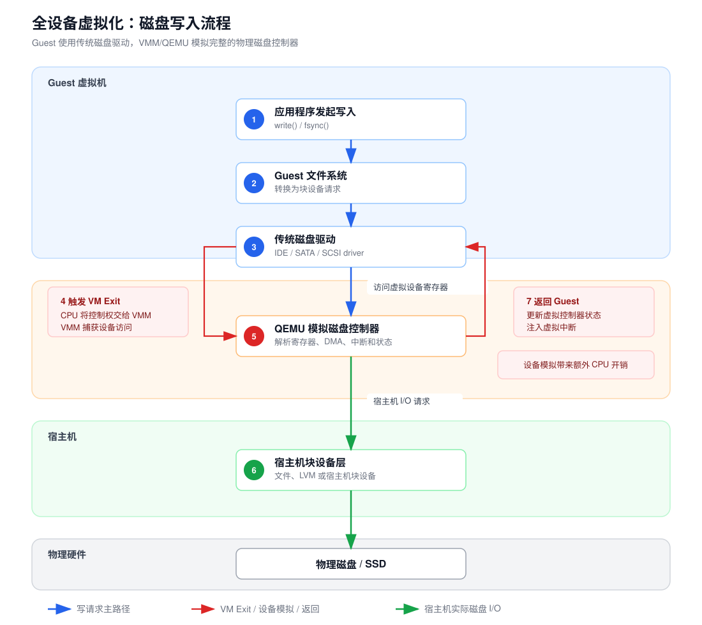
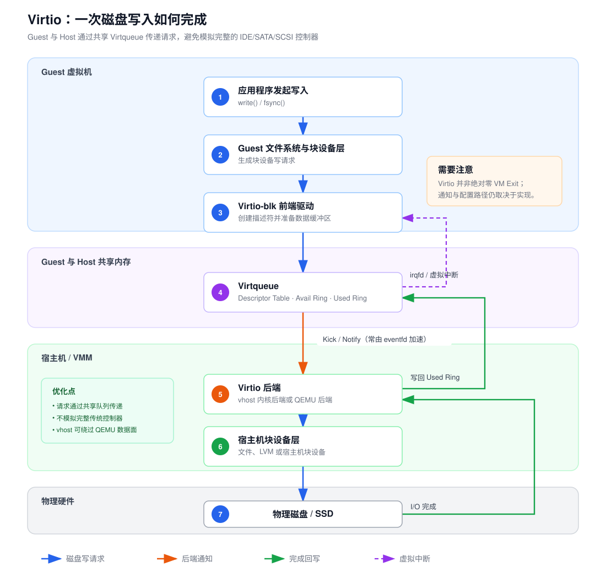
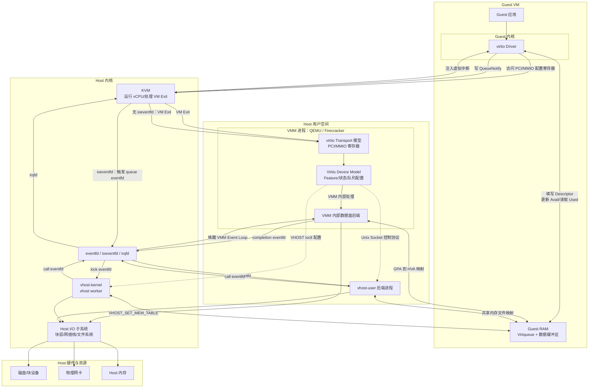
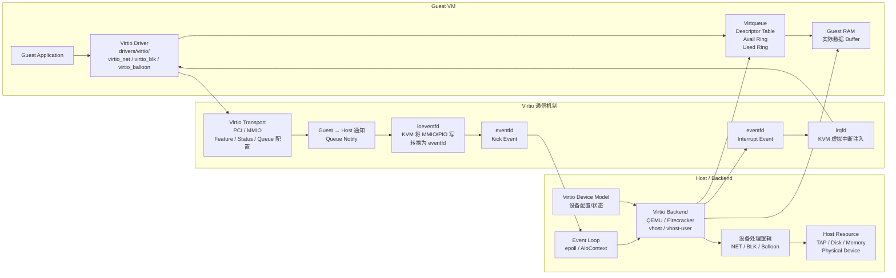
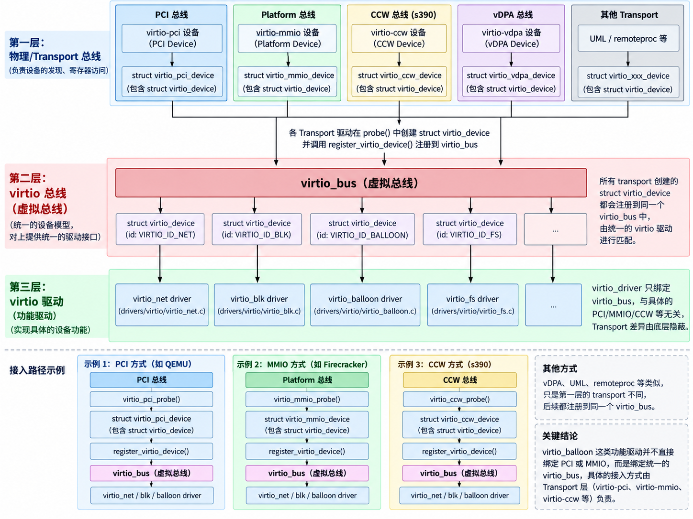
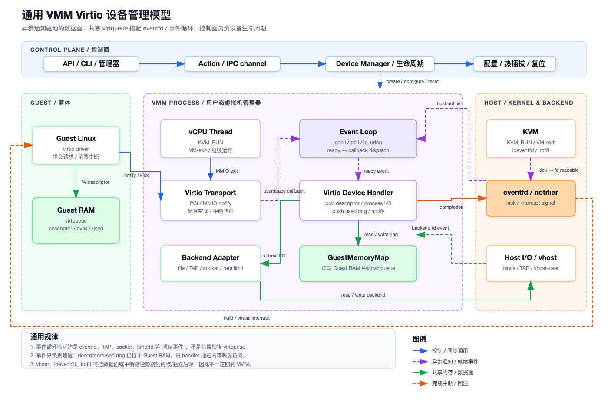
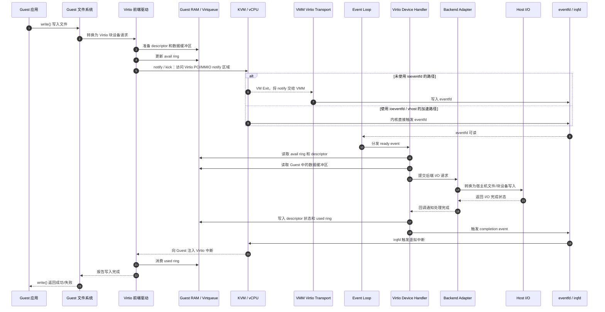
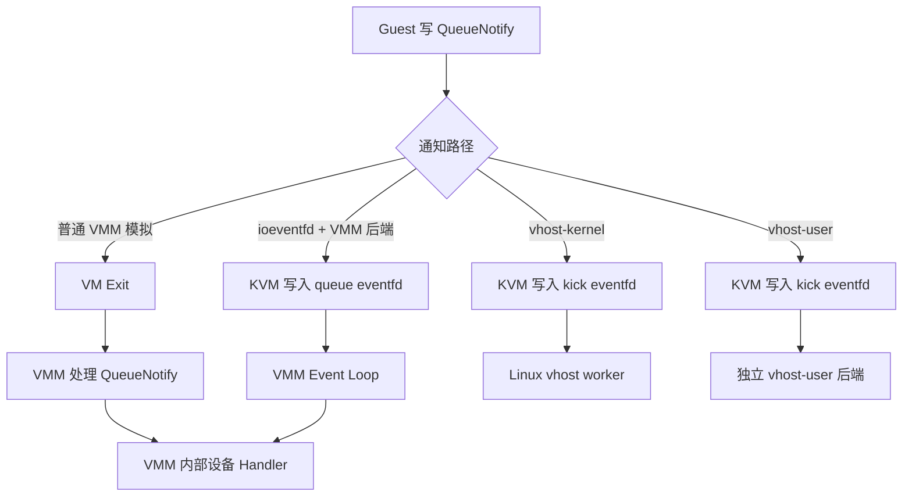
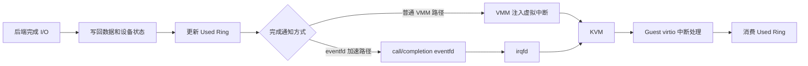

# vritio

Virtio 是一种虚拟化标准，用于提高虚拟化环境中I/O设备的性能。它通过半虚拟化技术，让客户机和宿主机之间的通信更高效。常见的应用包括网络、存储和图形设备。

​前端驱动（Guest Driver）​：安装在客户机中，直接与应用程序交互。
​后端驱动（Host Backend）​：宿主机中实现，处理前端驱动的请求（如 QEMU 模拟）。
​Virtio 环（Virtqueue）​：共享内存环形缓冲区，用于高效传输数据和控制信息。

## 为什么需要 ​Virtio

为什么需要 Virtio ？这里以访问磁盘为例举例说明。

### 全虚拟化



磁盘写入：

1. Guest 应用通过 `write()` 写入文件，Guest 文件系统将请求转换为块设备请求；
2. Guest OS 中的传统 IDE/SATA/SCSI 驱动准备好请求描述符，并通过访问虚拟磁盘控制器的寄存器通知设备；
3. 由于这是对虚拟硬件寄存器的访问，CPU 触发 VM Exit，由 KVM 接管；
4. KVM 将 VM Exit 原因返回给 QEMU，QEMU 识别出这是虚拟磁盘控制器的寄存器访问，并模拟 IDE/SATA/SCSI 控制器的行为；
5. QEMU 读取 Guest 内存中的数据，将其转换为宿主机的文件或块设备 I/O 请求，并提交给宿主机存储层；
6. 宿主机完成磁盘写入后，QEMU 更新虚拟控制器的状态和描述符，并通过虚拟中断通知 Guest；
7. KVM 再次执行 VM Entry，Guest OS 恢复执行并在中断处理程序中确认写入完成；

因此，一次普通的全虚拟化磁盘访问通常包含一次 Guest → VMM 的 VM Exit 和一次 VMM → Guest 的 VM Entry。这里的“前后端切换”不严格等同于操作系统进程之间的上下文切换。

### 半虚拟化



从图中的流程可以看出，在全虚拟化磁盘访问中，Guest 需要通过传统磁盘控制器寄存器提交请求。该访问会触发 VM Exit，KVM 再将退出原因交给 QEMU，由 QEMU 模拟磁盘控制器并执行宿主机 I/O，完成后再通过虚拟中断通知 Guest。

引入 Virtio 后，Virtio 前端驱动直接运行在 Guest 内核中。Guest 将磁盘请求描述符和数据放入共享的 Virtqueue，而不是逐次访问复杂的 IDE/SATA 控制器寄存器。宿主机的 Virtio 后端读取 Virtqueue 中的请求并执行磁盘 I/O。

在使用 `eventfd`、`irqfd`、`vhost` 等优化机制时，普通数据路径可以减少 QEMU 用户态参与，因而减少 Guest 与 VMM 之间的 VM Exit/VM Entry 切换。不过，Virtio 并不意味着任何实现下都绝对没有 VM Exit；通知后端、设备配置或未启用相关优化时，仍可能发生 VM Exit。

## virtio 的总体架构



​Virtio 的实现包含以下几个核心组件：

| 组件 | 主要实现位置 | 说明 |
|---|---|---|
| Virtio Driver | Guest OS 内核 | Linux 中位于 `drivers/virtio/`，负责创建 virtqueue、填充 descriptor、发送 kick、处理中断 |
| Virtqueue | Guest RAM + VMM/后端访问逻辑 | 环形队列数据结构位于 Guest 内存；Guest 写入 descriptor/avail，VMM 或 vhost 读取并写回 used |
| Virtio Device | VMM 或 vhost 后端 | Guest 看到的虚拟网卡、磁盘、balloon 等设备；具体设备模型可能由 VMM、内核 vhost 或独立 vhost-user 进程实现 |
| Virtio Transport | 通常由 VMM 实现 | 实现 PCI/MMIO 配置空间、设备状态、队列配置、notify 和中断接口 |
| eventfd | Host 用户态/内核协作 | 通知载体，由 VMM 创建和注册，可被 epoll/AioContext 监听 |
| ioeventfd | KVM + VMM 配置 | Guest 写 notify 地址时由 KVM 触发 eventfd，减少 VM-exit |
| irqfd | KVM + VMM 配置 | eventfd 被置位后由 KVM 向 Guest 注入虚拟中断 |

上述的virtio组件大致可以分为三种，分别是前后端和通信三个模块。


## virtio 的控制面和数据面

控制面负责建立设备运行所需的关系：
```text
设备发现
→ Feature 协商
→ 配置 virtqueue 地址和大小
→ 设置 DRIVER_OK
→ 激活设备和后端
→ reset/配置变化
```
控制面主要通过 PCI/MMIO transport 寄存器完成通常由 VMM 管理。

数据面负责实际 I/O：
```text
Guest 填写 Descriptor
→ 更新 Avail Ring
→ QueueNotify
→ 后端处理请求
→ 更新 Used Ring
→ 通知 Guest
```
数据本身放在 Guest RAM 中；寄存器和 eventfd 主要负责配置与通知。

## virtio设备的接入



## virtio 的事件驱动模型



这里触发过程如下：

1. Guest Linux 中的 Virtio 前端驱动把请求组织成 descriptor，写入 Guest RAM 中的 Virtqueue，并将队列中的可用项（avail ring）更新为可处理状态。
2. Guest 驱动通过 Virtio Transport（PCI 或 MMIO）发出 notify/kick，告诉后端“队列里有新请求”。Virtio 本身不要求这次通知一定触发 VM Exit：配置 `ioeventfd` 时，KVM 可以在内核中识别该 MMIO/PIO 写入并直接触发 eventfd；未配置时，才会 VM Exit 并回到 VMM 用户态处理。
3. eventfd 只是事件计数和唤醒机制，不承载 descriptor 或实际 I/O 数据。Event Loop 监听 eventfd，收到事件后调度 Virtio Device Handler。
4. Event Loop 通过 epoll、poll 或 io_uring 等机制等待 eventfd 变为可读，然后调度 Virtio Device Handler。Handler 从 GuestMemoryMap 访问 Guest RAM 中的 Virtqueue，读取 descriptor，校验请求，并把它转换成后端能够理解的 I/O 操作。
5. Backend Adapter 将请求提交给 Host I/O，例如宿主机文件、块设备、TAP 网卡或 socket。GuestMemoryMap 负责让 VMM 读写 Guest RAM 中的 descriptor 和数据缓冲区；它本身不是数据存储后端。

上面提到的 Descriptor 不是 I/O 数据本身，而是 Guest 放在 Virtqueue 中、用于描述一段数据缓冲区的元数据。一个 Descriptor 通常包含：

```c
struct virtq_desc {
    __le64 addr;   /* 数据缓冲区的 Guest Physical Address */
    __le32 len;    /* 缓冲区长度 */
    __le16 flags;  /* NEXT、WRITE、INDIRECT 等标志 */
    __le16 next;   /* 下一个 Descriptor 的索引 */
};
```

其中，`VRING_DESC_F_WRITE` 表示该缓冲区由设备写入 Guest；没有该标志时，通常表示设备从 Guest 读取该缓冲区。

多个通过 `next` 串联起来的 Descriptor 就组成 Descriptor Chain。它允许一个 Virtio 请求引用多段不连续的 Guest 内存，避免先把数据复制到连续内存中。例如，一个 Virtio 磁盘写请求通常可以由三段 Descriptor 组成：第一段存放请求头（操作类型和扇区号），第二段指向要写入磁盘的数据，第三段存放设备写回的状态字节。后端沿着这条链读取请求头和数据，完成 Host I/O 后，把处理结果写入状态 Descriptor，并将这条链对应的头部索引写入 Used Ring。

因此，Descriptor 可以看作“某一段 Guest 内存的地址说明”，Descriptor Chain 则是“一次完整 I/O 请求所引用的多段内存及其顺序”。Guest 驱动通过 Avail Ring 提交 Descriptor Chain 的头部索引，后端根据 `next` 找到整条链；处理完成后，后端通过 Used Ring 返回这条链已经完成。

下图是一次 I/O 请求从 Guest 产生，到 Host 完成处理并返回 Guest 的完整过程：



## Guest 如何通知设备

Guest virtio 驱动准备好请求后，首先在 Guest RAM 中填写 Descriptor Chain，将 Descriptor 头索引写入 Avail Ring，并更新 `avail_idx`。完成内存写入后，驱动通过 virtio-pci 或 virtio-mmio 提供的 QueueNotify 接口通知设备。

QueueNotify 只表示“virtqueue 中出现了新的可用请求”，不携带 Descriptor 或实际 I/O 数据。请求内容仍保存在 Guest RAM 中，数据面处理者收到通知后再读取 Avail Ring 和 Descriptor。

根据后端的位置和是否启用通知加速，QueueNotify 有以下几种处理方式：



未使用 ioeventfd 时，Guest 对 QueueNotify 寄存器的访问会触发 VM Exit，VMM 再调用设备处理函数。启用 ioeventfd 后，KVM 可以直接把该寄存器写操作转换为 eventfd 事件，避免为 QueueNotify 返回 VMM 主线程。

vhost-kernel 和 vhost-user 不是另外两种 virtio 协议，而是两种数据面部署方式。它们使用相同的 virtqueue，只是 kick eventfd 分别唤醒 Host 内核中的 vhost worker或独立用户态后端。

## 后端如何处理请求

数据面处理者被唤醒后，会根据 Avail Ring 找到 Guest 新提交的 Descriptor Chain。它首先读取 Descriptor 中记录的 GPA、长度和读写方向，然后利用 Guest 内存映射将 GPA 转换为当前后端能够访问的宿主机地址。

完整处理过程可以概括为：

```text
收到 QueueNotify/kick eventfd
└── 读取 Avail Ring
    └── 获得 Descriptor Chain
        ├── 检查 Descriptor 地址、长度和方向
        ├── 将 GPA 转换为后端可访问的地址
        ├── 解析具体设备请求
        ├── 执行宿主机 I/O
        ├── 将结果写回 Guest 数据或状态缓冲区
        └── 在 Used Ring 中写入完成记录
```

数据面处理者可能是 QEMU或Firecracker进程中的设备 Handler、Linux vhost worker、vhost-user 独立进程或硬件 vDPA。无论由谁处理，读取 Descriptor、访问 Guest 缓冲区和更新 Used Ring 的基本语义都相同。

## 设备如何通知 Guest 请求完成

后端完成 I/O 后，会先把读取结果或设备状态写回 Guest 提供的可写缓冲区，再向 Used Ring 添加完成项并更新 `used_idx`。Used Ring 表示某个 Descriptor Chain 已经被设备消费；具体请求的成功或失败状态还可能保存在设备协议规定的状态缓冲区中，例如 virtio-blk 请求末尾的状态字节。

完成数据写入后，设备根据通知抑制状态决定是否向 Guest 发送中断：



VMM 内部设备可以通过 virtio transport 的中断模型注入 INTx、MSI-X 或 MMIO 中断。vhost-kernel 和 vhost-user 通常触发 VMM 配置好的 call eventfd；如果该 eventfd 已注册为 KVM irqfd，KVM 可以直接向 Guest 注入虚拟中断。

中断本身不携带完成结果，它只是通知 Guest“Used Ring 中出现了新的完成项”。Guest virtio 驱动收到中断后读取 Used Ring，回收 Descriptor，并将请求结果返回给 Guest 上层子系统。

## 后端加速手段 vhost

普通 virtio、vhost-kernel 和 vhost-user 使用相同的 Guest virtio 驱动、transport 和 virtqueue 格式，主要区别是数据面由谁执行。

```text
VMM 内部后端
Guest QueueNotify
→ VMM 设备 Handler
→ Host I/O
→ VMM 更新 Used Ring并发送中断

vhost-kernel
Guest QueueNotify
→ kick eventfd
→ Linux vhost worker
→ Host I/O
→ call eventfd
→ Guest 中断

vhost-user
Guest QueueNotify
→ kick eventfd
→ 独立用户态后端
→ Host I/O
→ call eventfd
→ Guest 中断
```

普通 virtio 的控制面和数据面都可以位于 QEMU或Firecracker进程中。vhost-kernel 将高频数据面转移到 Host 内核，vhost-user则将数据面转移到独立用户态进程。VMM仍然负责向 Guest 暴露 virtio 设备、协商 Feature、配置队列地址并管理设备生命周期。

## 各种机制如何协作

virtio 各机制并不是相互独立的功能，而是共同构成一条完整的异步 I/O 链路：


Virtio Transport：完成设备发现、Feature 协商、队列配置和状态管理

Virtqueue：保存 Descriptor、待处理请求和完成记录

Guest Memory Mapping：让 VMM、vhost 或外部后端访问 Guest 队列和数据缓冲区

QueueNotify：Guest 表示已经向 Avail Ring 提交新请求

ioeventfd：将 QueueNotify 寄存器写操作直接转换为 eventfd 事件

Event Loop/vhost worker：收到事件后读取并处理 virtqueue

Used Ring：保存 Descriptor Chain 已经处理完成的记录

call eventfd/irqfd
└── 将后端完成事件转换为 Guest 虚拟中断

vhost
└── 决定数据面在 VMM、Host 内核、独立进程还是硬件中执行


这些机制的整体协作过程是：

```mermaid
flowchart LR
    A[Transport 完成设备初始化]
    B[Guest 在 Virtqueue 中提交请求]
    C[QueueNotify]
    D[VM Exit 或 ioeventfd/kick eventfd]
    E[VMM Handler/vhost worker/vhost-user]
    F[访问 Guest Memory并执行 Host I/O]
    G[写回状态并更新 Used Ring]
    H[VMM 中断或 call eventfd/irqfd]
    I[Guest 中断处理并消费 Used Ring]

    A --> B --> C --> D --> E --> F --> G --> H --> I
```



因此，virtio 的整体实现可以概括为：Transport 建立控制关系，Virtqueue承担请求和结果的数据交换，eventfd系列机制负责事件通知，VMM或vhost后端负责处理请求，Used Ring和虚拟中断负责将完成结果返回Guest。
